# ExperimentOS

**An end-to-end experimentation, causal-inference and uplift-analytics platform, built on 13,979,592 real users from Criteo's public advertising experiment.**

It answers the questions a growth team asks after a randomised test: *did it work, how big is the effect really, who responds, who should we treat, and is it worth it?* Then it goes one step further and asks what the data itself got wrong.

[](https://github.com/karansalot/ExperimentOS/actions/workflows/ci.yml)


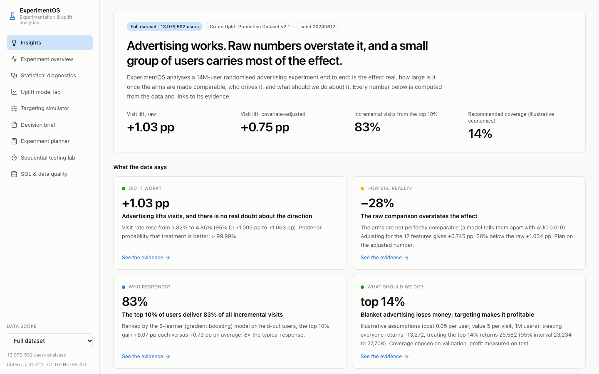

Every number in the dashboard is computed from the real file by a reproducible pipeline, cached as an artifact stamped with the dataset checksum and seed, and linked to the page that shows its evidence. Nothing is hard-coded, and nothing shown as a full-dataset result was computed on a sample.

---

## What the data says

Generated by the platform's own insight engine ([docs/INSIGHTS.md](docs/INSIGHTS.md)); full-dataset results.

| # | Finding | Number |
|---|---|---|
| 1 | **Advertising lifts visits.** 3.82% → 4.85%, 95% CI +1.005 to +1.063 pp; posterior P(better) > 99.99% | **+1.03 pp** |
| 2 | **The raw comparison overstates it.** The arms are subtly non-comparable (a classifier separates them with AUC 0.510). Doubly-robust adjustment gives +0.745 pp | **−28%** |
| 3 | **A few users carry the effect.** On held-out users, the top 10% by predicted uplift deliver 83% of all incremental visits, at 8× the average response | **83%** |
| 4 | **Blanket advertising loses money; targeting makes it pay.** Under illustrative costs, treating everyone returns −13.3K, treating the top 14% returns +25.6K (95% interval 23.2K to 27.7K) | **top 14%** |
| 5 | **Fancy models aren't the lever.** The best uplift model beats a plain response model by 8% (significant); for rare conversions, boosted uplift learners are *worse* | **+8%** |
| 6 | **The model's story is true.** Predicted segment uplift tracks observed doubly-robust uplift across 45 segments | **r = 0.99** |
| 7 | **Persuadables have a fingerprint.** 100% of the top decile sit off feature f8's modal value, vs 42% of everyone else | **100% vs 42%** |
| 8 | **The test was hugely overpowered.** Observed effect is 26× the minimum detectable effect; a 5% lift needed only 4.6% of these users | **26×** |
| 9 | **Peeking would have broken it.** Checking 10 times at p < 0.05 gives a 19% false-positive rate; O'Brien-Fleming restores 5% | **19%** |
| 10 | **The file is a trap.** It is stored in single-arm blocks: a `head -n` sample has no control group | **12 of 20 blocks** |

---

## The product

| | |
|---|---|
| **Insights** — auto-generated, evidence-linked findings and where the effect lives |  |
| **Experiment overview** — effects with intervals, three estimators, Bayesian read-out, non-compliance | 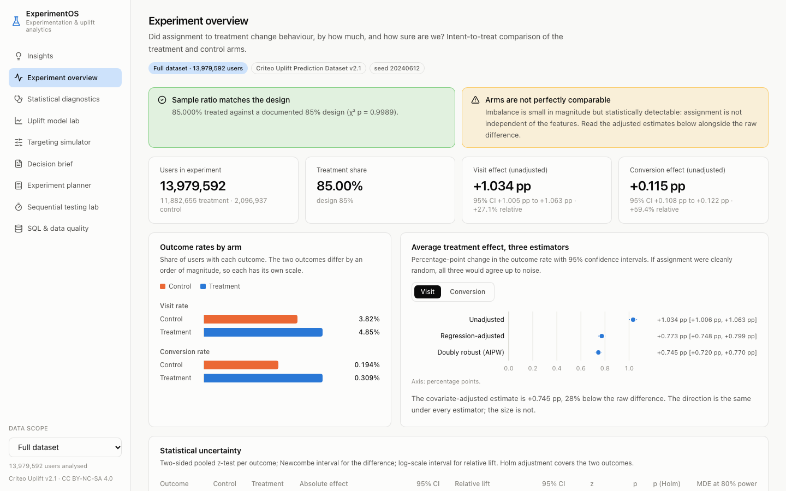 |
| **Statistical diagnostics** — SRM, covariate balance, classifier two-sample test, variance reduction, 45 segment tests with FDR control | 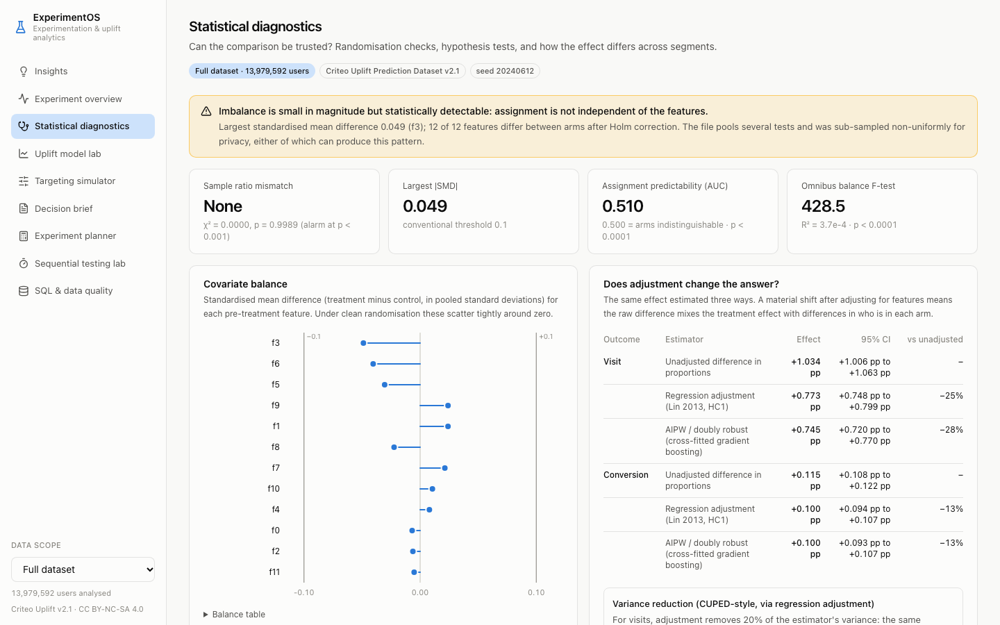 |
| **Uplift model lab** — five strategies, uplift and Qini curves with bootstrap bands, calibration, on-demand retraining | 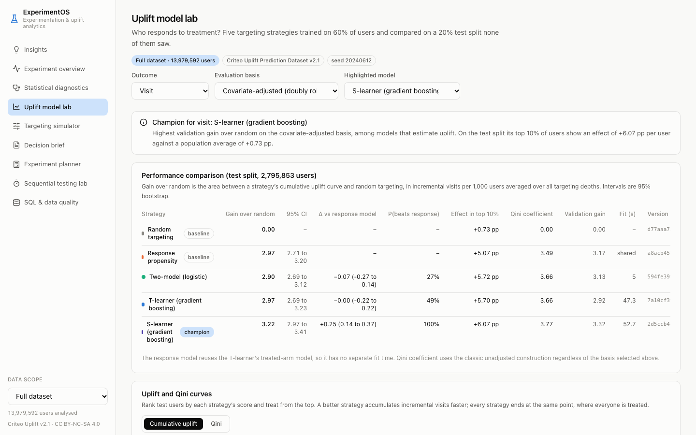 |
| **Explainability** — permutation importance, model-vs-data agreement, persuadables profile | 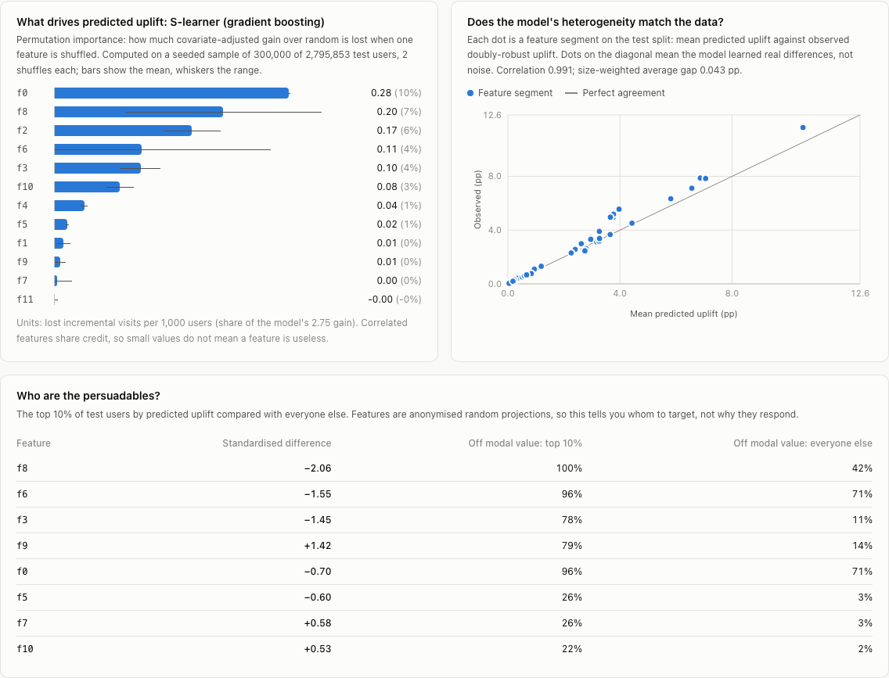 |
| **Targeting simulator** — cost, value, budget, risk tolerance → profit, break-even, sensitivity, deployable score cut-off, saved scenarios | 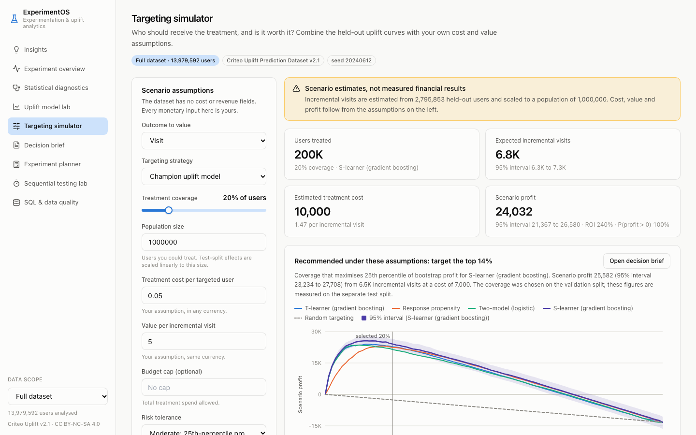 |
| **Experiment planner** — sample size, power curve, duration, cost of unbalanced allocation | 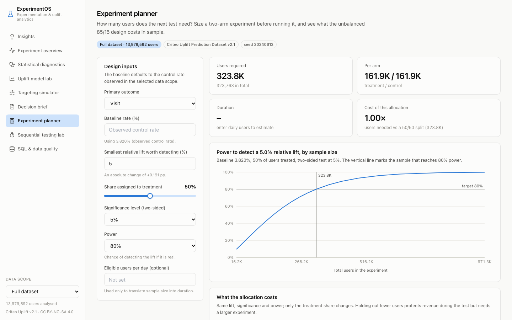 |
| **Sequential testing lab** — the cost of peeking, Pocock and O'Brien-Fleming boundaries | 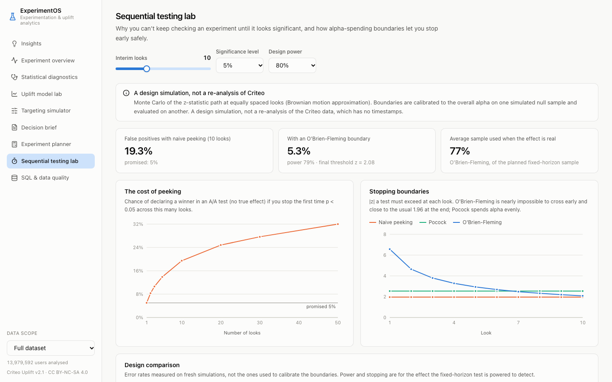 |
| **Decision brief** — stakeholder read-out, exportable as Markdown or PDF | 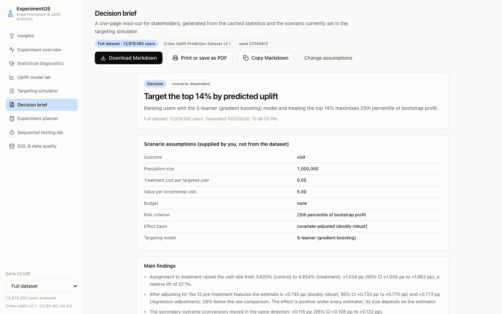 |
| **SQL & data quality** — 20 documented DuckDB queries and 12 validation rules, with results | 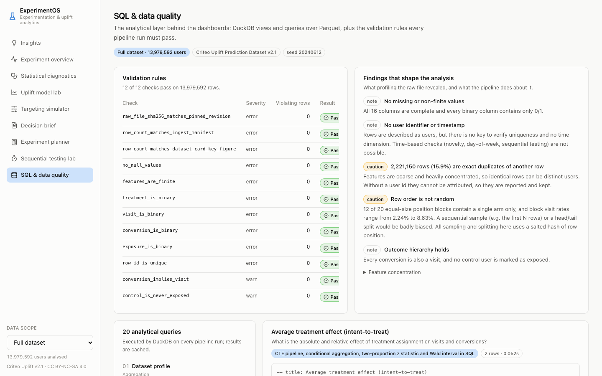 |

Dark mode follows the operating system: 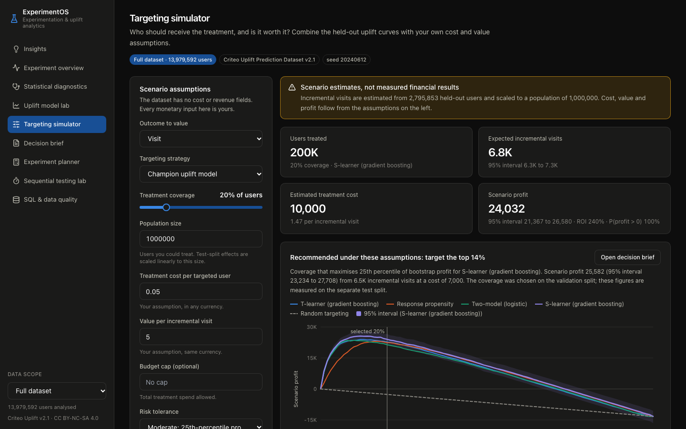

---

## What makes it different

- **It distrusts its own data.** It does not stop at the treatment-minus-control difference. It tests whether randomisation actually held, finds that it subtly did not, and carries a doubly-robust correction through effects, segments, model evaluation and the business simulator.
- **The evaluation is honest end to end.** Splits use hash-based assignment, models are fitted on train, the champion is chosen on validation, and results are reported on test. The recommended targeting depth is also chosen on validation and its profit measured on test, with uncertainty from a paired bootstrap.
- **Every statistic is tested against ground truth.** A synthetic experiment with a planted effect and confounded assignment goes through the real pipeline in CI. Estimators are checked against statsmodels and SciPy, interval coverage and power are verified by simulation, and sequential boundaries are checked against published constants.
- **It turns a model into a decision.** It reports break-even conditions, risk-adjusted coverage, a deployable rule ("treat users whose predicted uplift is at least +0.80 pp") and the size of the next experiment.
- **It scales without shortcuts.** All 14M rows go through DuckDB on a laptop. Statistics run on sufficient statistics and streamed matrix products. The browser only ever receives aggregates, and a test enforces that.

---

## Architecture

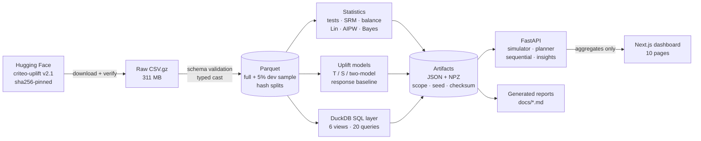

| Layer | Stack | Where |
|---|---|---|
| Data engineering | DuckDB, PyArrow, splitmix64 hashing | `backend/experimentos/data/` |
| SQL analytics | DuckDB SQL: CTEs, window functions, GROUPING SETS, PIVOT/UNPIVOT, QUALIFY | `backend/experimentos/sql/` |
| Experimentation statistics | NumPy, SciPy (statsmodels as test oracle) | `backend/experimentos/stats/` |
| Uplift modelling and explainability | scikit-learn | `backend/experimentos/uplift/` |
| Decision support | Python | `simulator/`, `brief.py`, `insights.py`, `stats/power.py`, `stats/sequential.py` |
| API | FastAPI, Pydantic | `backend/experimentos/api/main.py` |
| Dashboard | Next.js 14, TypeScript, Tailwind, shadcn-style components (Radix), Recharts | `frontend/` |
| Quality | pytest (119), Playwright (15), ruff, ESLint, GitHub Actions | `backend/tests/`, `frontend/e2e/`, `.github/workflows/` |

---

## Methods at a glance

| Question | Method |
|---|---|
| Is the split as designed? | Chi-square sample-ratio-mismatch test, alarm at p < 0.001 |
| Did randomisation hold? | Standardised mean differences, omnibus F-test, cross-fitted classifier two-sample test |
| How big is the effect? | Newcombe interval, log-scale relative interval, Holm across outcomes; Lin (2013) regression adjustment with HC1; cross-fitted AIPW |
| How sure are we? | Frequentist tests plus a Beta-Binomial posterior: P(better), credible intervals, expected loss |
| Can we test cheaper? | CUPED-style variance reduction: adjustment removes 19.5% of variance for visits, worth a 1.24× larger experiment |
| Effect per exposed user? | Wald/IV estimator under one-sided non-compliance, delta-method SE |
| Where does it differ? | 45 segment tests with BH and Holm, Cochran Q heterogeneity, doubly-robust segment effects |
| Who should we treat? | Two-model, T-learner, S-learner vs response and random baselines; uplift and Qini curves, AUUC, uplift@k, calibration, paired Poisson bootstrap |
| Why does the model rank that way? | Permutation importance on ranking value, predicted-vs-observed segment agreement, persuadables profile |
| Is it worth it? | Profit = value × N × gain(φ) − cost × N × φ; budget cap; risk-adjusted coverage chosen on validation; break-even; sensitivity |
| How big should the next test be? | Pooled-null / unpooled-alternative power formula, verified by simulation |
| Can we look early? | Monte Carlo of the z-statistic path; Pocock and O'Brien-Fleming boundaries |

Full detail, assumptions and limitations: [docs/METHODOLOGY.md](docs/METHODOLOGY.md).

---

## Quick start

Requirements: Python 3.9+, Node 20+, pnpm.

```bash
git clone https://github.com/karansalot/ExperimentOS && cd ExperimentOS
make setup        # virtualenv + backend + frontend dependencies
make api          # FastAPI on http://127.0.0.1:8765
make web          # dashboard on http://localhost:3000 (second terminal)
```

The repository ships the cached artifacts, so the dashboard works immediately without downloading anything. To reproduce everything from the raw data:

```bash
make data             # download 311 MB (sha256-verified) and build Parquet
make pipeline-sample  # ~5% development sample, ~20 s
make pipeline-full    # all 13,979,592 rows, ~12 min on a 10-core laptop
make reports          # regenerate docs/RESULTS.md, INSIGHTS.md and the reports
make test             # 119 backend tests on a synthetic ground-truth fixture
make test-e2e         # 15 Playwright tests against the real API
```

The full scope (all rows) and the development scope (a deterministic ~5% hash sample) are never mixed. Every artifact and API response carries its scope, and the dashboard shows a badge on every page and a warning banner whenever the sample is selected.

---

## Documentation

| Document | What's in it |
|---|---|
| [Key insights](docs/INSIGHTS.md) | the ten findings above, generated |
| [Results snapshot](docs/RESULTS.md) | effects, validity checks, default scenario, generated |
| [Methodology](docs/METHODOLOGY.md) | estimands, every method, assumptions, limitations |
| [Model evaluation report](docs/MODEL_EVALUATION_REPORT.md) | strategies, metrics with intervals, calibration, explainability, generated |
| [Data quality report](docs/DATA_QUALITY_REPORT.md) | source, validation rules, duplicates, file-order structure, generated |
| [SQL catalog](docs/SQL_CATALOG.md) | 20 queries and the technique each demonstrates |
| [Executive case study](docs/CASE_STUDY.md) | the business read-out |
| [Interview guide](docs/INTERVIEW_GUIDE.md) | design decisions, trade-offs and likely questions |
| [Three-minute demo script](docs/DEMO_SCRIPT.md) | a timed walkthrough |
| [Deployment guide](docs/DEPLOYMENT.md) | local, containers, configuration, CI |
| [Implementation status](IMPLEMENTATION_STATUS.md) | what is done, verified and still open |

---

## Data and license

Diemert, E., Betlei, A., Renaudin, C., & Amini, M.-R. (2018). *A Large Scale Benchmark for Uplift Modeling.* AdKDD & TargetAd Workshop, KDD 2018. Dataset: <https://huggingface.co/datasets/criteo/criteo-uplift>, **CC BY-NC-SA 4.0**. The raw data is not redistributed; `make data` downloads it from the publisher. The committed artifacts are aggregate statistics derived from it and carry the same terms. Code is MIT-licensed ([LICENSE](LICENSE)).
